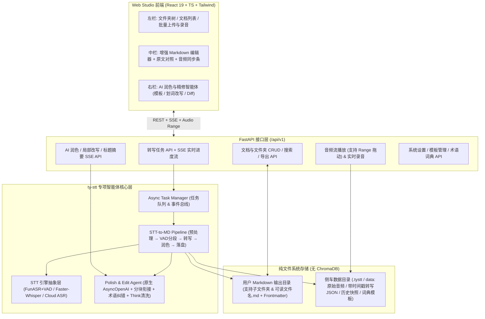

# ty-voice → ty-stt 重构方案设计

> **目标定位**：将原有的多智能体语音问答系统 `ty-voice` 重构为专注、轻量化、高精度的 **语音转文字与智能文稿精修专项智能体（`ty-stt`）**。彻底移除 LangChain / LangGraph / ChromaDB / TTS / 语音对话模块，以**本地文件夹 Markdown 直存**为核心，全面增强 **STT 语音识别精度、大模型润色改写能力、音文联动编辑体验**，并重新设计现代化的 Web 工作台。

---

## 一、现状诊断与重构痛点分析

通过审查当前代码库，现有实现存在以下核心问题与历史包袱，将在本次重构中一并解决：

| 维度 | 现状问题（代码位置） | 重构目标 |
| :--- | :--- | :--- |
| **依赖与框架过重** | [requirements.txt](file:///e:/taiyi-soft/ty-stt/requirements.txt) 引入 `langchain`、`langgraph`、`chromadb`、`ddgs`；[markdown.py](file:///e:/taiyi-soft/ty-stt/app/services/markdown.py) 仅为一次 LLM 调用却套壳 `create_agent` | 彻底移除 LangChain/LangGraph/ChromaDB，采用 **原生 `openai` 异步 SDK + 轻量 Python 专项智能体编排** |
| **功能发散** | 包含 TTS（CosyVoice）、RAG 向量化入库、Web 搜索、WebSocket 语音聊天，与“语音转文字整理”主线冲突 | 聚焦 **录音/音频 → 高精度转写 → AI 润色精修 → Markdown 文件夹直存与管理** |
| **STT 能力受限** | [stt.py](file:///e:/taiyi-soft/ty-stt/app/services/stt.py) 仅做固定时长硬切片（易截断词句），`segments=[]` 恒为空，无时间戳，音频时长始终为 `0.0` | 引入 **VAD 智能断句 + 词句级时间戳 + 热词注入 + 插件化多引擎（FunASR / Whisper / 云端 API）** |
| **LLM 润色单一且有缺陷** | 仅写死单一 Prompt，未利用根目录已整理的分层提示词；实测 [doc_20260127001341_5faacf87.md](file:///e:/taiyi-soft/ty-stt/data/docs/doc_20260127001341_5faacf87.md) 出现 Qwen3 `<think>` 推理标签直接污染正文的问题 | 支持 **多场景/多强度模板库、长文分段润色、术语纠错词典、划词局部改写、Diff 对比、流式输出与 `<think>` 自动剥离** |
| **阻塞上传与假进度** | [audio.py](file:///e:/taiyi-soft/ty-stt/app/api/v1/audio.py) 同步阻塞直到 STT+LLM 全部完成（长音频极易超时）；[KnowledgePage.tsx](file:///e:/taiyi-soft/ty-stt/web/src/pages/KnowledgePage.tsx) 使用定时器模拟假进度条 | 改为 **后台异步任务队列 + SSE 实时进度与流式文本推送**，支持批量上传与浏览器直接录音转写 |
| **存储与编辑体验弱** | 文档以无意义 ID 存放且受限于 `draft → indexing → ready` 向量库状态机；[DocumentEditor.tsx](file:///e:/taiyi-soft/ty-stt/web/src/components/knowledge/DocumentEditor.tsx) 为简陋弹窗 `<textarea>`，无法对照原录音校对 | **直接保存为可读 `.md` 文件到指定文件夹**（带 YAML Frontmatter）；重做三栏工作台，支持 **音文同步校对、高级编辑器、AI 润色副驾驶** |

---

## 二、清理与精简清单（减法）

### 1. 依赖精简 (`requirements.txt`)
- **移除**：`langchain`、`langchain-openai`、`langgraph`、`langchain-chroma`、`chromadb`、`ddgs`
- **新增/保留**：
  - Web 核心：`fastapi`、`uvicorn[standard]`、`python-multipart`、`pydantic-settings`、`sse-starlette`
  - LLM 客户端：`openai`（统一兼容 Ollama / DeepSeek / Qwen / OpenAI / vLLM 等所有 OpenAI-Compatible API）
  - STT 与音频：`funasr`、`torch`、`transformers`（可选扩展：`faster-whisper`）
  - 工具库：`pyyaml`（处理 Markdown Frontmatter）、`pytest`、`httpx`

### 2. 删除废弃模块与目录
- **后端删除**：
  - `app/graphs/`（`ingest_graph.py`、`qa_stream_graph.py`、`monitoring.py`）
  - `app/agents/`（旧空目录，改为新的轻量专项智能体模块 `app/agent/`）
  - `app/services/tts.py`、`vectorstore.py`、`embeddings.py`、`chunking.py`、`qa.py`、`websearch.py`
  - `app/api/v1/chat.py`、`search.py`、`ws.py`（旧 TTS 语音对话 WebSocket）
  - `app/schemas/chat.py`、`search.py`
  - `src/`（重复的旧入口文件）
- **数据目录清理**：
  - 归档或移除 `data/chroma/`、`data/tts/`
- **前端删除**：
  - `web/src/pages/VoiceAgentPage.tsx`、`web/src/hooks/useChatStream.ts`
  - 旧 `knowledgeStore.ts` 中的“确认入库/向量化”状态与逻辑
- **配置项迁移**：
  - 环境变量前缀由 `TYVOICE_*` 统一重构为 `TYSTT_*`（可短期保留旧变量回退读取以平滑过渡）。

---

## 三、目标系统架构设计

放弃重型通用编排框架，采用 **FastAPI + 原生异步管道 + 专项精修智能体 + 本地 Markdown 文件系统** 的简洁高内聚架构：



---

## 四、核心模块详细设计

### 1. 文件系统 Markdown 直存方案 (`app/storage/`)

**核心理念**：文档即文件，所见即所得。生成的 `.md` 文件直接保存在指定的本地文件夹中，天然兼容 Obsidian、Typora、VS Code 与 Git。

- **目录结构设计**：
  ```text
  workspace/                        # 可配置的 Markdown 输出根目录 (TYSTT_OUTPUT_DIR)
  ├── 未分类/
  │   └── 2026-11-26_项目复盘会议.md
  ├── 课程笔记/
  │   └── 2026-11-25_易经地变卦象解析.md
  └── 访谈稿/

  data/                             # 内部支撑数据目录 (TYSTT_DATA_DIR)
  ├── audio/                        # 原始与标准化音频 (供音文同步回放)
  ├── transcripts/                  # 带时间戳的结构化转写 JSON ({doc_id}.json)
  ├── snapshots/                    # 文档编辑历史快照 (支持一键回滚)
  ├── prompts/                      # 内置 + 用户自定义润色提示词模板 (YAML/JSON)
  └── glossary.json                 # 全局/领域热词与纠错术语表
  ```
- **Markdown YAML Frontmatter 规范**（嵌入 `.md` 文件头部，编辑时可折叠隐藏，导出时可选保留或剥离）：
  ```yaml
  ---
  doc_id: doc_20261126_a1b2c3d4
  title: 项目复盘会议
  created_at: 2026-11-26T10:30:00+08:00
  updated_at: 2026-11-26T10:45:12+08:00
  source_audio: meeting_1126.m4a
  duration_seconds: 1842.5
  stt_engine: funasr
  polish_preset: medium
  tags: [会议, 复盘]
  ---
  ```
- **状态机大幅简化**：彻底取消 `draft / indexing / ready` 向量库状态；转写完成即直接落盘为可用 `.md` 文档，任务状态仅存在于任务队列中（`queued → preprocessing → transcribing → polishing → completed / failed`）。
- **轻量全文搜索**：直接扫描输出目录 `.md` 文件名、Frontmatter 标签与正文，毫秒级返回匹配片段（个人/团队数千篇文档完全无需数据库）。

---

### 2. 语音转写 (STT) 能力增强 (`app/stt/`)

1. **引擎抽象与多后端支持 (`BaseSTTEngine`)**：
   - `FunASREngine`（默认）：升级现有加载逻辑，集成 **VAD（`fsmn-vad`）智能端点检测** + 标点恢复（如 `ct-punc`，按模型能力自动启用），根据真实静音停顿切分音频，彻底消除固定秒数硬切导致的“词语拦腰截断”问题。
   - `WhisperEngine`（可选扩展）：支持 `faster-whisper` 本地推理（对中英混杂/多语种极佳）。
   - `OpenAIASREngine`（可选扩展）：兼容 OpenAI Whisper API / 硅基流动 / 阿里云百炼等云端转写接口，方便无 GPU 机器使用。
2. **结构化时间戳输出 (`TranscriptResult`)**：
   - 真正填充 `segments: list[TranscriptSegment]`（`id`, `start_ms`, `end_ms`, `text`, 可选 `speaker`），保存为 `data/transcripts/{doc_id}.json`。
   - 引入 `ffprobe` 自动提取准确音频时长、声道、采样率，写入元数据。
3. **热词与领域词典增强**：
   - 支持配置全局/单次转写热词（如“地变、井卦、既济卦、FastAPI”），在转写时自动注入 FunASR `hotword` 参数，提升专有名词召回率。
4. **多种输入源支持**：
   - 单文件 / 多文件批量拖拽上传（后台并发/排队处理）。
   - **浏览器实时麦克风录音**：前端录制高音质音频（实时显示声波振幅与录制时长，支持暂停/继续），停止后一键触发转写与润色。
   - 音频格式扩展：支持 `mp3 / wav / m4a / webm / flac / ogg / aac / mp4(提取音轨)`。

---

### 3. 大模型修改与润色专项智能体 (`app/agent/`)

1. **原生 `AsyncOpenAI` 统一适配层 (`app/llm/client.py`)**：
   - 抛弃 LangChain，直接使用官方 `openai.AsyncOpenAI`。
   - 支持灵活切换本地 Ollama（如 `qwen3:8b`、`qwen2.5:14b`）或云端模型（DeepSeek / Qwen / Claude-proxy / OpenAI），支持在 Web 界面实时修改 Base URL、API Key、Model 与 Temperature。
   - **推理标签清洗器**：自动识别并剥离 `<think>...</think>`（兼容未闭合流式场景），可将思考过程作为独立事件推送供调试查看，绝不污染最终 Markdown 正文。
2. **分层润色模板体系**（深度整合项目根目录现有提示词资产）：
   - **仅转写（不润色）**：直接生成带段落/时间戳的原始逐字稿 Markdown。
   - **轻度纠错**：最大限度保留原话，仅修错别字、同音误识、标点和明显语病。
   - **中度润色（默认推荐）**：去口语填充词（“呃/然后/就是说”）、理顺语序、自然分段、**严格反幻觉（不总结/不扩写/不添观点）**。
   - **重度精修**：转换为正式书面文稿/可发表文章风格，自动生成层级标题。
   - **结构化纪要**：自动整理为「标题 + 核心摘要 + 分点论述/行动项 (Action Items)」，适合会议与课程。
   - **自定义模板**：用户可在界面新建、编辑、保存常用 Prompt 模板。
3. **长文本智能分块与上下文衔接润色**：
   - 当转写稿超过单次最佳上下文窗口（如 > 2500 字）时，智能体按句子/时间停顿自动切分为语义块；每块携带前一块末尾 200 字作为上下文参考（`prev_context`）逐块流式润色并无缝拼接，避免长录音漏字、截断或风格漂移。
   - 自动在收尾阶段由智能体提炼**建议文件名/文档标题与标签**（用户可采纳或覆盖）。
4. **术语纠错词典（Glossary）注入**：
   - 支持配置「同音错词 → 标准写法」规则表（如 `机器挂 -> 既济卦`、`太一 -> 太夷`），自动注入系统提示词，专治专业领域语音误识。
5. **编辑态 AI 精修副驾驶 (`EditCopilotAgent`)**：
   - **全文重润色**：对已有文档切换不同润色模板或模型，基于“原始转写稿”或“当前正文”重新生成。
   - **划词局部精修**：选中任意段落，执行快捷指令（润色通顺 / 修正错别字 / 精简压缩 / 转为列表或表格 / 结合原始逐字稿核对还原）或输入自由修改要求。
   - **安全 Diff 审阅**：AI 修改建议以 **行级/词级 Diff 对比** 展示，支持一键「应用替换」「插入下方」或「放弃」，不盲目覆盖人工编辑心血。

---

### 4. Web 前端全新设计 (`web/`)

彻底摒弃旧版“语音对话机器人”的页面结构，重新设计为 **专注、高效、现代的音文精修 Studio**：

```text
+------------------+------------------------------------------+------------------------+
|  [ty-stt Logo]   |  📁 课程笔记 / 易经地变卦象解析.md  [已保存] |  ✨ AI 精修助手    [x] |
|  [+ 新建转写]    |  [源码] [分屏] [预览] [对比原稿]  [导出]  |                        |
|  [🎙 实时录音]   +------------------------------------------+  润色模式: [中度润色 v]|
|                  |  [可折叠: 原始逐字稿 (带时间戳)]          |  术语词典: [已启用 12条]|
|  🔍 搜索文档...   |  00:12 地气从下而上蒸腾形成湿气...       |  [⚡ 基于原稿重新润色]  |
|                  |  00:45 井卦讲的是地水相交...              |                        |
|  任务队列 (1)    +------------------------------------------+  ──── 快捷精修 ────    |
|  ● 会议.m4a 64%  |  # 地变与卦象解析                         |  [修错字] [理顺语序]   |
|                  |                                          |  [转列表] [生成摘要]   |
|  📁 全部文档     |  地气从下而上蒸腾，形成湿气与虚气...      |                        |
|  ├─ 📁 会议纪要  |  （支持划词浮窗呼出 AI 局部改写 + Diff）  |  ──── 对话修改 ────    |
|  ├─ 📁 课程笔记  |                                          |  "把第三段改成更正式的  |
|  │  └─ 易经...   |                                          |   书面语，并加上小标题" |
|  └─ 📁 未分类    |                                          |  [Diff 预览 -> 应用]   |
|                  +------------------------------------------+                        |
|  ⚙ 系统设置      | ▶ 01:24 / 18:30 ▁▃▅▇▃▁▅▂▁  [1.0x] [↺-3s] |                        |
+------------------+------------------------------------------+------------------------+
```

#### 核心前端升级点：
1. **全新视觉与交互体系**：
   - 采用现代简洁的编辑器工作台美学（浅色/深色模式可选，清晰排版层次，高阅读舒适度）。
   - 三栏可拖拽调宽/折叠布局，小屏自适应。
2. **文档编辑器能力跃升**：
   - 升级普通 `<textarea>` 为专业编辑器（推荐 **CodeMirror 6** 作为 Markdown 编辑内核，原生支持语法高亮、查找替换 `Ctrl+F`、多光标、撤销/重做历史、行号与折叠，同时提供分屏实时渲染预览与阅读模式）。
   - 支持 **自动保存（防抖 1.5s）** + `Ctrl+S` 立即保存 + 历史版本快照一键恢复。
   - 支持 **大纲导航 (TOC)**、字数统计、快捷格式工具栏（标题/加粗/列表/引用/表格/分割线）。
   - **一键导出**：复制纯文本、复制 Markdown、下载 `.md` 文件、打开本地保存路径提示。
3. **音文联动校对系统**：
   - 底部常驻轻量音频播放器（支持 HTML5 Range 流式拖动、`0.75x ~ 2.0x` 倍速、全局快捷键 `Alt+Space` 播放/暂停、`Alt+←/→` 快退/快进 3 秒）。
   - 可展开「原始逐字稿参考栏」：展示带时间戳的分段原稿，**点击任意时间段直接跳转播放对应位置音频**，方便听音核对专业术语与漏词。
4. **统一新建转写弹窗 / 抽屉**：
   - 支持多文件批量拖拽上传 + 现场选择目标文件夹、润色预设模板、附加本次热词。
   - 内置 **实时录音面板**：声波可视化 + 计时器 + 暂停/继续 + 录音结束自动进入转写润色流程。
5. **完善的设置中心（激活原占位按钮）**：
   - LLM 配置（服务商 URL、API Key、模型选择、一键连通性测试）。
   - STT 配置（引擎选择、设备 CPU/CUDA、VAD 开关、默认语言）。
   - 存储配置（Markdown 输出根目录路径展示与切换、文件命名规则）。
   - Prompt 模板库与术语纠错词典可视化 CRUD。

---

## 五、重构后目录结构与 API 规划

### 1. 后端目录结构 (`app/`)
```text
app/
├── main.py                      # FastAPI 入口、生命周期与静态资源/CORS配置
├── core/
│   ├── config.py                # Pydantic Settings (TYSTT_*) + 运行时配置持久化
│   ├── errors.py                # 统一异常处理
│   └── logging.py               # 结构化日志
├── api/v1/
│   ├── routes.py                # 路由汇总 + /health
│   ├── transcriptions.py        # 上传/批量上传/录音提交、任务列表、SSE 进度流、取消/重试
│   ├── documents.py             # 文档列表/搜索/读取/更新/重命名/移动/删除/快照回滚/导出
│   ├── folders.py               # 文件夹树获取、新建、重命名、删除
│   ├── polish.py                # 全文重润色(SSE)、局部改写(SSE)、自动标题摘要
│   ├── audio.py                 # 音频文件 Range 流式播放接口
│   └── settings.py              # 系统设置、Prompt模板、术语词典 CRUD、LLM连通测试
├── agent/
│   ├── pipeline.py              # 音文转写精修主管道 (预处理→STT→润色→落盘)
│   ├── polish_agent.py          # 长文分块润色智能体 + 术语纠错 + Think标签清洗
│   ├── copilot_agent.py         # 编辑态划词改写/自由指令修改智能体
│   └── prompts.py               # 分层提示词模板加载与渲染引擎
├── llm/
│   └── client.py                # 原生 AsyncOpenAI 封装 (流式/非流式/Think解析)
├── stt/
│   ├── base.py                  # BaseSTTEngine & TranscriptSegment 协议
│   ├── audio_proc.py            # ffprobe 时长探测 + ffmpeg 转码标准化
│   ├── funasr_engine.py         # FunASR + VAD + 热词 + OOM 自适应回退
│   └── whisper_engine.py        # 可选: Faster-Whisper / OpenAI ASR 适配
├── storage/
│   ├── markdown_store.py        # 文件夹树管理、Frontmatter 解析/写入、安全路径校验
│   ├── sidecar_store.py         # 音频、时间戳转写JSON、版本快照管理
│   └── task_manager.py          # 异步任务队列 + 内存/文件状态持久化 + SSE 广播
└── schemas/                     # 清晰的 Pydantic 请求/响应模型
```

### 2. 核心 API 契约概览
| 分类 | 方法与路径 | 说明 |
| :--- | :--- | :--- |
| **转写任务** | `POST /api/v1/transcriptions` | 上传音频（支持多文件/录音），指定 `folder`、`preset`、`hotwords`，立即返回 `task_id` |
| | `GET /api/v1/transcriptions` | 获取当前与历史任务队列状态 |
| | `GET /api/v1/transcriptions/{task_id}/events` | **SSE 实时推送**（阶段进度%、STT 分段实时文本、LLM 流式润色文本、完成后的 `doc_id`） |
| **文件夹** | `GET /api/v1/folders` | 获取输出目录完整文件夹树与文档计数 |
| | `POST / PATCH / DELETE /api/v1/folders` | 新建、重命名、删除文件夹 |
| **文档管理** | `GET /api/v1/documents` | 按文件夹/标签/关键词搜索列出 Markdown 文档 |
| | `GET / PUT / DELETE /api/v1/documents/{doc_id}` | 读取（含正文、Frontmatter、时间戳逐字稿）、保存更新、删除 |
| | `POST /api/v1/documents/{doc_id}/move` | 移动文档到其他文件夹或重命名 `.md` 文件 |
| | `GET / POST /api/v1/documents/{doc_id}/snapshots` | 查看历史快照与一键回滚 |
| **AI 润色** | `POST /api/v1/polish/document` | **SSE 流式**基于原稿或当前正文按指定模板/模型重新润色 |
| | `POST /api/v1/polish/selection` | **SSE 流式**划词局部修改/自由指令改写，前端展示 Diff |
| **音频回放** | `GET /api/v1/audio/{doc_id}` | 支持 `Range` 请求头的音频流，供编辑器拖动进度校对 |
| **配置管理** | `GET / PUT /api/v1/settings` | 运行时配置（LLM / STT / 输出路径）读写与连通性测试 |
| | `GET / POST / PUT / DELETE /api/v1/prompts` | 润色提示词模板管理 |
| | `GET / PUT /api/v1/glossary` | 术语纠错与热词表管理 |

---

## 六、分阶段实施路线图

### Phase 1：架构瘦身与存储底座（预计工作量：小）
1. 清理 `langchain`、`langgraph`、`chromadb`、`tts`、`qa`、`websearch` 等废弃代码与依赖。
2. 建立新的 `app/core/config.py`（`TYSTT_*` 配置体系 + 运行时配置文件覆盖）。
3. 实现 `app/storage/markdown_store.py` 与 `sidecar_store.py`：支持文件夹树、YAML Frontmatter、可读 `.md` 文件直存、路径穿越安全校验、版本快照。
4. 编写一次性迁移脚本，将现有 `data/docs/*.md`（自动清理 `<think>` 块）与音频/元数据迁移至新结构。

### Phase 2：STT 增强、任务队列与 AI 润色智能体（预计工作量：中）
1. 重构 `app/stt/`：集成 `ffprobe` 时长探测、FunASR + VAD 智能分段、时间戳 `segments` 输出与热词注入。
2. 实现 `app/llm/client.py`（原生 `AsyncOpenAI` + `<think>` 自动过滤与流式解析）。
3. 实现 `app/agent/polish_agent.py` 与 `copilot_agent.py`：内置根目录分层提示词模板、长文分块上下文润色、术语纠错注入、划词局部改写。
4. 实现 `app/storage/task_manager.py` 与所有 `/api/v1/*` REST + SSE 接口，并补齐后端 `pytest` 测试套件。

### Phase 3：Web Studio 前端全面重构（预计工作量：中-大）
1. 搭建新三栏工作台布局（文件夹树、文档列表、任务队列面板、深浅色主题）。
2. 集成增强型 Markdown 编辑器（CodeMirror 6 + 分屏实时预览 + 大纲 + 自动保存 + 快照历史）。
3. 实现底部音文联动播放器 + 可折叠时间戳逐字稿对照栏（点击跳转播放、倍速与快捷键）。
4. 实现右侧 AI 精修副驾驶面板（模板切换、全文流式重润色、划词改写、Diff 对比接受/拒绝）。
5. 实现批量上传拖拽、浏览器实时麦克风录音面板、设置中心（LLM / STT / 提示词 / 术语词典）。

### Phase 4：全链路联调、验收与文档更新
1. 端到端测试：上传音频 / 实时录音 → SSE 进度 → 转写与润色 → 音文校对与 AI 局部修改 → 本地文件夹查看生成的 `.md` 文件。
2. 更新 `README.md`、`.env.example` 与启动脚本。
